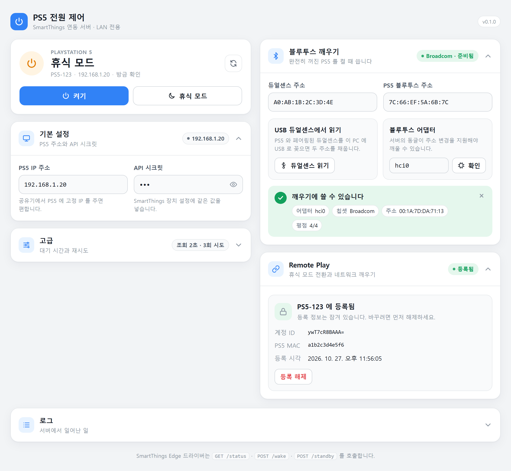
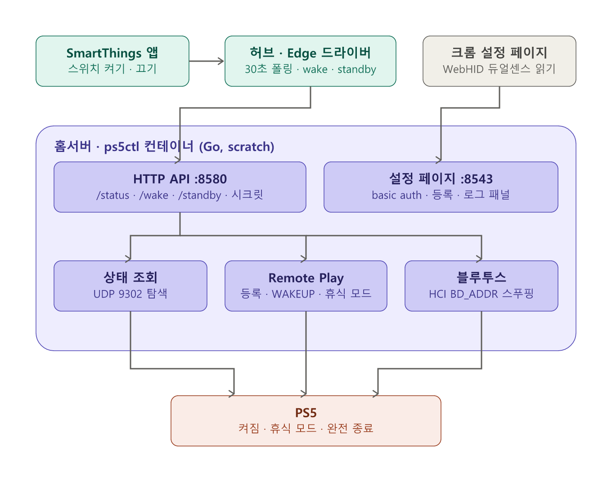
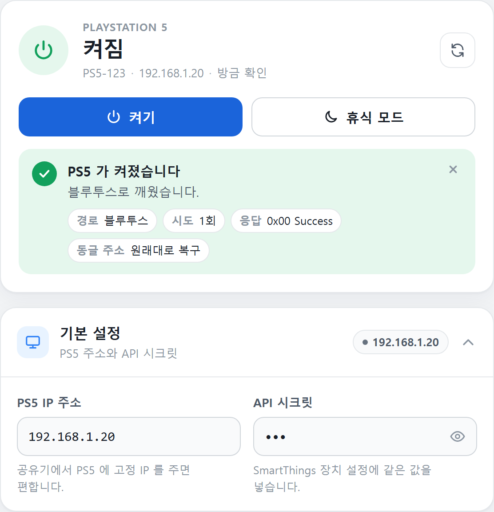
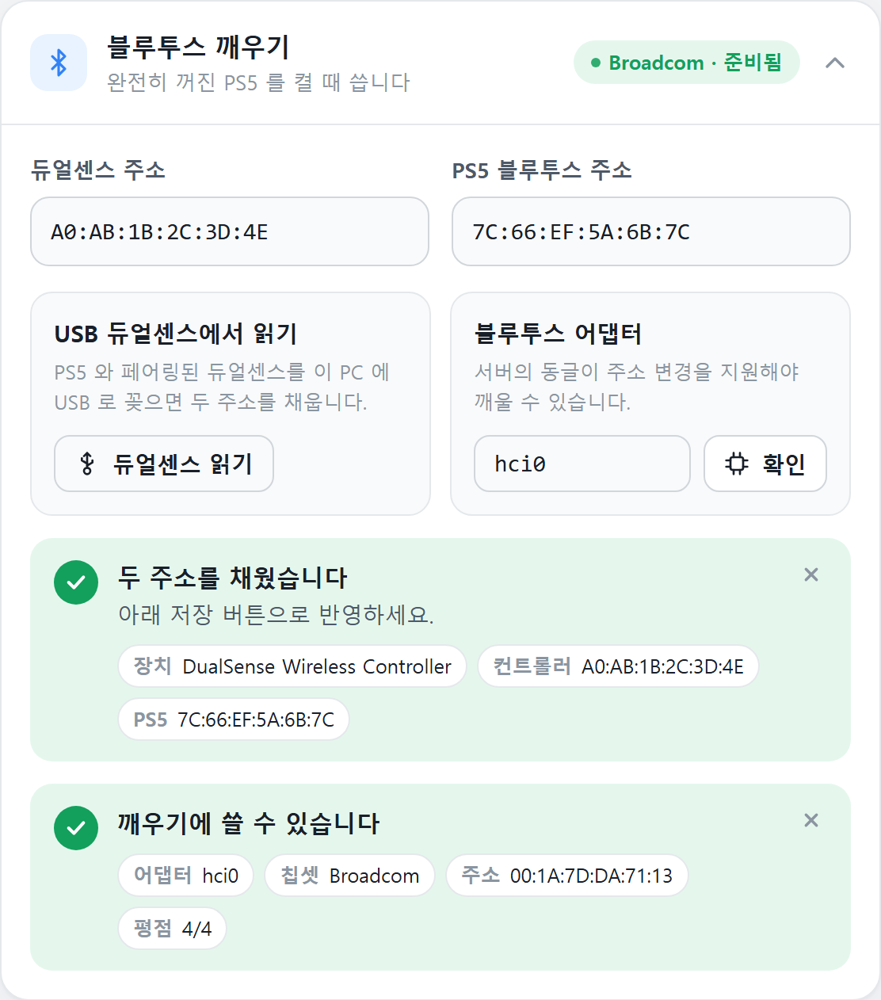
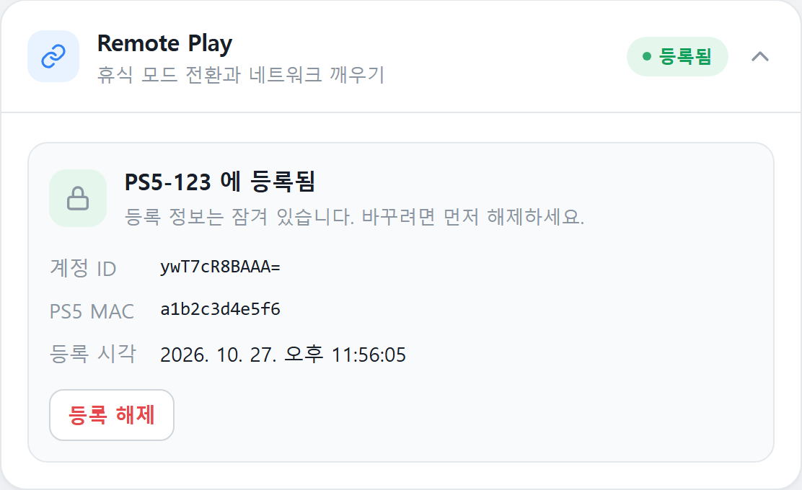
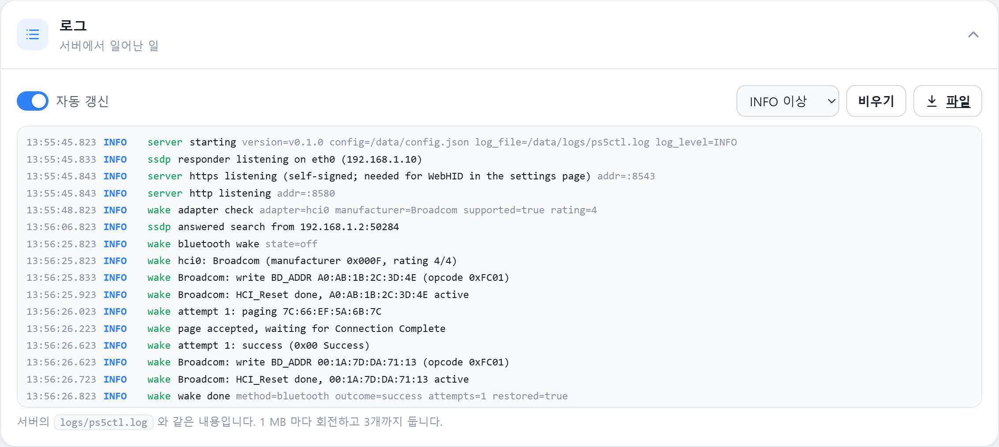

# SmartThings PS5 Control

**홈서버 컨테이너 하나로 PS5 전원 상태를 보고, 블루투스·Remote Play 로 켜고 재우는 SmartThings 연동** 
PS5 power state, Bluetooth wake and Remote Play rest mode from a tiny home-server container, with its own SmartThings Edge driver

[한국어](#한국어) · [English](#english)

---

## 한국어

Go 정적 바이너리 하나가 `scratch` 이미지로 홈서버(리눅스)에서 돌면서 PS5 전원 상태를 조회하고, 휴식 모드의 PS5 는 네트워크로, 완전히 꺼진 PS5 는 블루투스로 깨우며, 켜진 PS5 를 휴식 모드로 보냅니다.
전용 SmartThings Edge 드라이버가 허브 안에서 로컬로 이 API 를 호출합니다. 실제 PS5 와 Broadcom 동글, SmartThings Station 에서 검증했습니다.

### 무엇을 할 수 있나

- **전원 상태** — PS5 의 UDP 9302 탐색 프로토콜로 켜짐 · 휴식 모드 · 꺼짐을 구분합니다. 인증이 필요 없고, 휴식 모드 응답은 PS5 의 "인터넷에 연결된 상태 유지" 가 켜져 있어야 합니다.
- **블루투스 깨우기** — 동글의 BD_ADDR 를 PS5 에 페어링된 듀얼센스 주소로 바꾼 뒤 PS5 를 페이지합니다. PS5 는 페이지의 출발 주소만 보고 켜지므로 링크키가 필요 없습니다. 끝나면 동글 주소를 되돌립니다.
- **Remote Play 로 휴식 모드 · 네트워크 깨우기** — 설정 페이지에서 PS5 에 Remote Play 클라이언트로 등록(PSN 계정 ID + PS5 의 PIN)하면 켜진 PS5 를 휴식 모드로 보내고, 휴식 모드의 PS5 는 블루투스 없이 네트워크로 깨웁니다. 블루투스는 완전 종료 상태에서만 필요합니다. playactor(ISC) 의 PS5 구현을 Go 로 옮겼습니다.
- **설정 페이지** — PS5 IP · API 시크릿 · 블루투스 주소 · 어댑터 · Remote Play 등록을 카드로 다루고, 상태 조회 · 켜기 · 휴식 모드 · 어댑터 확인 버튼으로 바로 시험합니다. 크롬에서 USB 로 꽂은 듀얼센스를 읽어(WebHID) 두 주소를 채우고, 로그 패널이 서버에서 일어난 일을 보여 줍니다.
- **SmartThings 장치** — 스위치(켜기 = 깨우기, 끄기 = 휴식 모드) 아래에 전원 상태(켜짐 · 휴식 모드 · 꺼짐 · 깨우는 중), 서버 연결, 마지막 깨우기(시각 · 경로 · 결과), 마지막 휴식 모드(결과와 실패 사유), 블루투스 동글, Remote Play 등록, 버전 줄이 있고 모두 루틴 조건으로 쓸 수 있습니다. 주변 기기 검색(SSDP)으로 서버를 찾아 장치를 만듭니다.
- **작게** — 외부 의존성은 `golang.org/x/sys` 뿐, 이미지는 수 MB, 메모리 제한 32 MB 로 돕니다.

### 어떻게 동작하나

허브의 드라이버와 설정 페이지는 둘 다 컨테이너의 HTTP API 만 부릅니다. 컨테이너가 PS5 쪽 세 가지 경로(탐색 프로토콜 · Remote Play 세션 · 블루투스 페이지)를 모두 맡습니다.

### 설치

1. 홈서버에 저장소를 받고 `.env.example` 을 `.env` 로 복사해 설정 페이지 계정을 정합니다.
2. `docker compose pull && docker compose up -d` — 이미지는 `ghcr.io/protomothis/smartthings-ps5-control`(직접 빌드하려면 `up -d --build`; 호스트 네트워크, `NET_ADMIN` · `NET_RAW`, `./data` 볼륨). 컨테이너 없이 쓰려면 [Releases](https://github.com/Protomothis/smartthings-ps5-control/releases) 의 `ps5ctl-linux-amd64` · `arm64` 바이너리에 `setcap cap_net_raw,cap_net_admin+eip` 를 주고 `ps5ctl serve` 로 띄웁니다.
3. `https://<서버>:8543/` 을 열고 자체서명 인증서를 한 번 허용합니다. **기본 설정**에 PS5 IP 와 **API 시크릿**을 넣고 **저장**합니다.
4. **블루투스 깨우기** 카드에서 **확인**으로 동글 칩셋이 지원되는지 보고, 듀얼센스를 PC 에 USB 로 꽂아 **듀얼센스 읽기**로 두 주소를 채운 뒤 **저장**. PS5 를 완전히 끄고 **켜기**로 시험합니다.
5. **Remote Play** 카드에서 PSN 계정 ID(base64 12자 또는 숫자 ID)와 PS5 의 설정 → 시스템 → 리모트 플레이 → 기기 연결에 뜨는 PIN 으로 [등록]. 이후 **휴식 모드** 버튼과 네트워크 깨우기가 동작합니다. 등록은 잠기므로 바꾸려면 먼저 [등록 해제].
6. 채널 **Protomothis** 초대 링크를 열고 [Enroll] → 허브 선택: <https://bestow-regional.api.smartthings.com/invite/Kr2zNWYgpp2A> — 채널의 **SmartThings PS5 Control** 드라이버를 [Install] 합니다.
7. SmartThings 앱 **[+] → 기기 추가 → 주변 기기 검색** → 컨테이너가 SSDP 로 답해 주소가 채워진 PS5 장치가 생깁니다(Remote Play 를 등록했다면 PS5 의 이름으로). 장치 설정에 **API 시크릿**을 넣습니다. 검색이 안 되는 서브넷이면 **서버 주소**를 직접 넣습니다.

 

### 블루투스 동글

BD_ADDR 변경은 표준 HCI 명령이 없어 칩셋별 벤더 명령을 씁니다. 설정 페이지의 **확인**(또는 `ps5ctl adapter`)으로 미리 보세요.

| 칩셋 (SIG ID) | 명령 | 검증 |
|---|---|---|
| Broadcom (0x000F) · Cypress (0x0131) | 0xFC01 | **이 프로젝트에서 검증** (ASUS USB-BT400) · RPi 내장칩은 상위 구현에서 검증됨 |
| Intel (0x0002) | 0xFC31 | 상위 구현에서 AX201 검증됨 |
| MediaTek (0x0046) | 0xFC1A | 상위 구현에서 MT7921 검증됨 |
| TI · Atheros · Qualcomm ROME | 0xFC06 / 0xFC0B | 커널 소스 기준, 미검증 |
| CSR (0x000A) | BCCMD | 미구현 |
| Realtek (0x005D) | 없음 | 런타임 변경 불가. 펌웨어 config 교체 방식은 범위 밖 |

### 포트와 API

| 주소 | 용도 | 인증 |
|---|---|---|
| `http://<서버>:8580/status` | 전원 상태 JSON (`state`: on / standby / off) 와 드라이버 화면용 `server` 블록(버전 · 동글 · Remote Play · 마지막 깨우기). 드라이버가 폴링 | 없음 (LAN 전용) |
| `http://<서버>:8580/wake` (POST) | 깨우기. 켜져 있으면 그대로, 휴식 모드면 네트워크(등록 시), 아니면 블루투스. `?method=network\|bluetooth` 로 고정. 200 성공 · 504 무응답 · 501 동글 미지원 · 423 진행 중 · 409 설정 없음 | `X-PS5-Secret` (시크릿을 정했을 때) |
| `http://<서버>:8580/standby` (POST) | 휴식 모드(Remote Play 세션). 200 성공 · 504 미확인 · 409 미등록 · 502 세션 실패 | `X-PS5-Secret` (시크릿을 정했을 때) |
| `https://<서버>:8543/` | 설정 페이지 (`/api/config`, `/api/info`, `/api/remoteplay*`, `/api/logs` 포함) | basic auth |
| `/api/adapter`, `/healthz`, `/ssdp.json` | 동글 정보, 헬스체크, SSDP 응답이 가리키는 설명(설치 ID · 이름 · 포트) | 없음 |

환경변수: `PS5_AUTH_USER` · `PS5_AUTH_PASS`(없으면 설정 페이지가 503 으로 닫힘), `PS5_HTTP_ADDR`(`:8580`), `PS5_HTTPS_ADDR`(`:8543`), `PS5_TLS_HOSTS`, `PS5_DATA`(`/data`), `PS5_LOG_LEVEL`(`info`; `debug` 면 HTTP 요청까지), `PS5_SSDP`(`on`; `off` 면 허브의 검색에 답하지 않음), `TZ`(`Asia/Seoul`; 상태·로그의 시각이 이 시간대로 찍히고 드라이버는 그대로 보여 줌).
CLI 로도 같은 일을 합니다: `ps5ctl status --ip <PS5>` · `sudo ps5ctl adapter` · `sudo ps5ctl wake --controller … --ps5 …` · `ps5ctl rp account|register|wake|standby`.

### Remote Play 와 로그

 

등록 키는 `/data/config.json` 에만 있고 API 는 가립니다. 로그는 컨테이너 로그와 `data/logs/ps5ctl.log`(1 MB × 3개 회전)에 같이 남고, 깨우기 한 번의 전 과정(경로 선택, 칩셋, 주소 교체, 시도마다의 상태 코드, 원복)이 `wake:` 줄로 보입니다.

### 문제 해결

- **깨우기가 `timeout`** — PS5 가 꺼진 채 블루투스 거리 밖이거나, 컨트롤러 주소가 PS5 의 페어링 목록에 없습니다. 듀얼센스를 PS5 에 한 번 페어링한 뒤 주소를 다시 읽으세요.
- **`unsupported`** — 동글 칩셋이 BD_ADDR 변경을 지원하지 않습니다(Realtek · CSR). 위 표의 칩셋으로 바꿔야 합니다.
- **WebHID 버튼이 꺼져 있음** — HTTP 로 열었거나 크로미움 계열이 아닙니다. `https://…:8543/` 을 크롬 · 엣지로 여세요.
- **읽은 PS5 주소가 `00:00:00:00:00:00`** — 그 컨트롤러는 아직 PS5 와 블루투스로 페어링된 적이 없습니다.
- **휴식 모드인데 `off`** — PS5 설정 → 시스템 → 절전 → 휴식 모드 중 사용 가능한 기능 → "인터넷에 연결된 상태 유지".
- **Remote Play 등록이 안 됨** — PS5 의 "리모트 플레이 활성화" 가 켜져 있고 기기 연결 화면이 열려 있어야 하며, 서버와 PS5 가 같은 서브넷이어야 합니다(등록 검색은 UDP 9295). `80108b09` 는 PIN 오류, `80108b02` 는 계정 ID 오류입니다.
- **휴식 모드 전환이 `passcode`** — PS5 사용자에 로그인 비밀번호가 걸려 있으면 세션을 열 수 없습니다. 비밀번호를 풀거나 비밀번호 없는 사용자로 등록하세요.
- **주변 기기 검색에 아무것도 안 나옴** — 허브와 서버가 같은 서브넷인지, 로그에 `ssdp: responder listening on …` 과 검색 때 `answered search from <허브 IP>` 가 찍히는지 봅니다. 아무 줄도 없으면 멀티캐스트가 서버까지 오지 않는 것이고(VLAN · Wi-Fi 클라이언트 격리), 그때는 장치 설정의 **서버 주소**에 직접 넣습니다.
- **블루투스로 켜면 TV 도 같이 켜짐** — HDMI 기기 연동(CEC)입니다. PS5 설정 → 시스템 → HDMI → "HDMI 기기 연동 활성화" 를 끄면 PS5 만 켜집니다.

### 보안

- 설정 페이지와 설정 API 는 basic auth, `/wake` · `/standby` 는 API 시크릿(`X-PS5-Secret`)입니다. 시크릿이 비어 있으면 LAN 의 누구나 깨우고 끌 수 있으니 정하세요. `/status` 는 인증이 없습니다. 어느 쪽이든 **LAN 밖으로 노출하지 마세요**.
- 서버는 PSN 에 로그인하지도, 소니 서버와 통신하지도 않습니다. 계정 ID 는 직접 넣습니다.
- 자체서명 인증서는 `/data/tls/` 에 있고 WebHID 의 보안 컨텍스트를 위한 것입니다. 지우면 다시 만듭니다.
- 컨테이너는 `cap_drop: ALL` 에 `NET_ADMIN` · `NET_RAW` 만 더하고 읽기 전용 루트로 돕니다.

### 문서와 개발

- 변경 이력: [CHANGELOG](CHANGELOG.md)(서버) · [edge/CHANGELOG](edge/CHANGELOG.md)(드라이버)
- 개발: [CONTRIBUTING.md](CONTRIBUTING.md)(브랜치 · 커밋 · 테스트 · 릴리스 규칙), 드라이버는 [`edge/README.md`](edge/README.md), 결정과 근거는 [`docs/design.md`](docs/design.md)
- 참고 구현: [FreeTHX/pywakepsx-on-bt](https://github.com/FreeTHX/pywakepsx-on-bt)(칩셋별 스푸핑의 원본), [gamahacka/ps5-wake-bluetooth-linux](https://github.com/gamahacka/ps5-wake-bluetooth-linux)(Realtek 우회), [dhleong/playactor](https://github.com/dhleong/playactor)(Remote Play 등록·세션의 원본, ISC)

### 후원

이 프로젝트는 무료이고, 모든 기능은 앞으로도 무료입니다. 쓰시다가 도움이 됐다면 ⭐ Star나 [GitHub Sponsors](https://github.com/sponsors/Protomothis)로 응원해 주세요. 후원금은 블루투스 동글과 SmartThings 허브처럼 실제 환경에서 검증하는 데 씁니다. 버그 제보와 다른 동글의 실기 결과 공유도 큰 도움이 됩니다.

---

## English

A single static Go binary in a `scratch` image on a Linux home server reads the PS5's power state, wakes it over the network from rest mode or over Bluetooth from full power-off, and puts it into rest mode. A dedicated SmartThings Edge driver calls it locally from the hub. Verified on a real PS5 with a Broadcom dongle and a SmartThings Station.

### What it does

- **Power state** — the PS5's UDP 9302 discovery protocol tells on, rest mode and off apart. No authentication; rest mode only answers with "Stay connected to the Internet" enabled.
- **Bluetooth wake** — the dongle's BD_ADDR is rewritten to that of a DualSense paired with the console, the console is paged, and the address is restored. Supported chipsets: Broadcom, Cypress, Intel, MediaTek (TI, Atheros and Qualcomm ROME untested); Realtek and CSR cannot be used.
- **Remote Play for rest mode and network wake** — register the service as a Remote Play client on the settings page (PSN account ID + the PIN the PS5 shows); then a console that is on can be put into rest mode, and one in rest mode is woken over the network. A Go port of the PS5 parts of playactor (ISC).
- **Settings page** — cards for the PS5 IP, API secret, Bluetooth addresses and adapter, Remote Play registration and the server log, with status / wake / rest-mode / adapter buttons. In Chrome, a DualSense plugged in by USB is read over WebHID to fill in both addresses.
- **SmartThings device** — a switch (on = wake, off = rest mode) plus power state, server connection, last wake, Bluetooth dongle, Remote Play and version rows, all usable as routine conditions. Found by *Scan nearby* (SSDP).

### Install

1. On the home server, copy `.env.example` to `.env`, set the settings-page credentials and run `docker compose up -d` (image `ghcr.io/protomothis/smartthings-ps5-control`; host network, `NET_ADMIN` + `NET_RAW`, `./data` volume). Linux binaries are on [Releases](https://github.com/Protomothis/smartthings-ps5-control/releases).
2. Open `https://<server>:8543/`, accept the self-signed certificate once, enter the PS5 IP and an API secret, save. Press **Check** on the Bluetooth card, plug a DualSense into the PC by USB, press **Read DualSense**, save, and try **Wake** with the console fully off.
3. On the Remote Play card, register with your PSN account ID and the PIN from the PS5's *Remote Play → Link Device* screen; rest mode and network wake then work.
4. Open the **Protomothis** channel invite <https://bestow-regional.api.smartthings.com/invite/Kr2zNWYgpp2A>, enroll your hub and install **SmartThings PS5 Control**. Then **[+] → Add device → Scan nearby** in the SmartThings app and enter the API secret in the device settings (set the server address by hand only when discovery cannot cross your subnet).

`GET /status` on port 8580 is unauthenticated; `POST /wake` and `POST /standby` take the API secret in `X-PS5-Secret`; all are meant for the LAN only. The settings page on 8543 uses basic auth. Details and troubleshooting are in the Korean section above.

### Docs

[CONTRIBUTING.md](CONTRIBUTING.md), [`edge/README.md`](edge/README.md) and [`docs/design.md`](docs/design.md) (Korean).

### Sponsor

This project is free, and every feature will stay free. If it helps you, a ⭐ star or [GitHub Sponsors](https://github.com/sponsors/Protomothis) keeps it going: sponsorship pays for real-device testing such as Bluetooth dongles and SmartThings hubs. Bug reports and test results from other dongles help just as much.

---

## License

[MIT](LICENSE)
